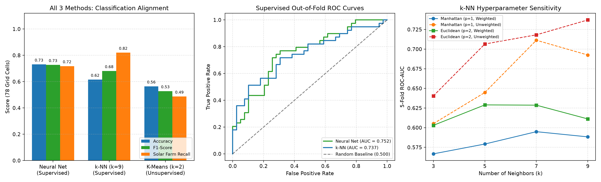
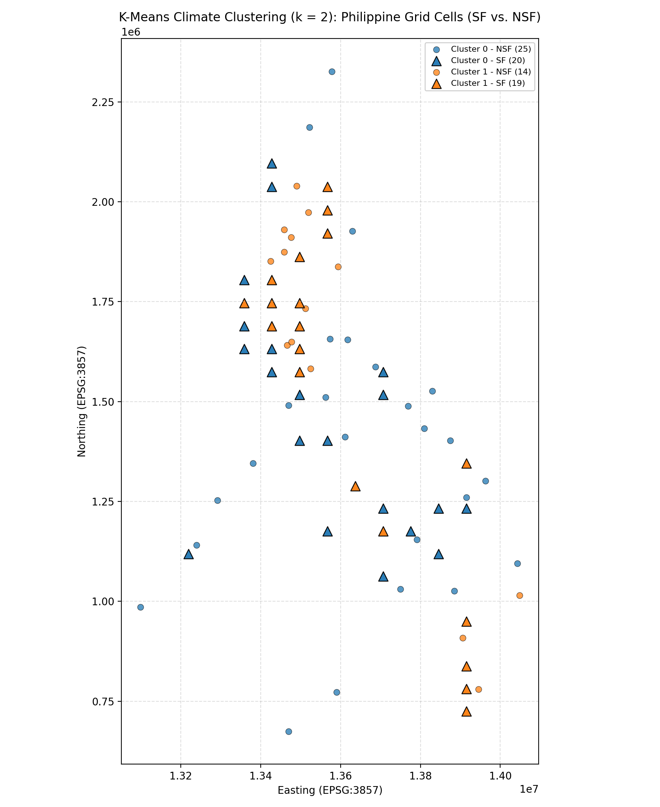

# Climate-Based Site Suitability Modeling for Philippine Utility-Scale Solar Farms Using NASA POWER Data

**CMSC 170: Introduction to Artificial Intelligence — Laboratory Project (EF-1L, Group 2)**  
**Project Page:** https://dan-willborromeo.github.io/CMSC-170-NASA-Power/  
**Repository:** https://github.com/Dan-WillBorromeo/CMSC-170-NASA-Power  
**Presentation Slides:** https://docs.google.com/presentation/d/1j7adnXtO2-CzJRf6TJyDyJVQ1btlZ-iR_bugGQqXmCA/edit  

### Group Members
* **Borromeo, Daniel William R.** — Neural Network Architecture, Training Pipeline, Negative Grid Sampling, Cross-Validation Benchmark
* **Lagman, Johann Gabriel S.** — k-Nearest Neighbors Implementation, Cross-Validation Benchmark, Unified Evaluation & Repository Standardization
* **Dayahan, Rey Russel M.** — Unsupervised K-Means Clustering Implementation, Regime Analysis & Geospatial Visualization
* **Plaza, Martin Adrian** — DOE Solar Farm Geolocation & NASA POWER Dataset Aggregation

---

## 1. Problem Statement and Motivation

As the Philippines expands its renewable energy capacity to reduce fossil-fuel dependence, selecting locations for utility-scale solar photovoltaic (PV) farms remains a high-stakes spatial decision. While solar potential is often evaluated using average solar irradiance alone, real-world PV performance across the Philippine archipelago is strongly governed by seasonal monsoon cloud cover, inter-annual variability, ambient heat (which reduces panel efficiency), relative humidity, wind cooling, and extreme rainfall events.

**Objective:** This project models whether a geographic grid cell in the Philippines exhibits the multi-variable historical climate profile of an established commercial solar farm (`1` / SF) versus a non-solar-farm location (`0` / NSF) using historical satellite-derived meteorological data from **NASA POWER**. We compare three distinct AI paradigms—a **Feedforward Neural Network**, **k-Nearest Neighbors (k-NN)**, and **Unsupervised K-Means Clustering**—implemented from scratch in Python.

---

## 2. Dataset Description & Preprocessing

### Data Sources
1. **Department of Energy (DOE) Philippines — Awarded Solar Projects (as of August 31, 2026):** Filtered for utility-scale projects in **Commercial Operation** with installed capacity >= 1 MW (108 commercial solar farms mapped to geographic coordinates in `Datasets/Philippine-Commercial-Solar-Farms.csv`).
2. **NASA POWER (Prediction Of Worldwide Energy Resources):** Daily meteorological and solar irradiance time-series (`MERRA-2` at 0.5° x 0.625° and `CERES SYN1deg` at 1° x 1° spatial resolution) for historical years (`YEAR < 2026`).

### Dataset Size & Structure
Because multiple solar installations can fall inside the same NASA spatial grid cell, facilities were grouped by unique NASA grid cell, yielding a balanced binary dataset of **78 grid cells** stored in `Datasets/`:
* `Datasets/Weather (SF)/` — **39 positive grid cells** containing active commercial solar farms (`label = 1`)
* `Datasets/Weather (NSF)/` — **39 negative reference grid cells** without commercial solar farms (`label = 0`)

### Feature Engineering (12 Climate Profile Features)
Daily raw weather records (filtering out `-999` missing-value sentinels and records from `YEAR >= 2026`) are aggregated per grid cell into a **12-dimensional climate fingerprint**:

| # | Feature | NASA Parameter(s) | Definition |
| :- | :--- | :--- | :--- |
| 1 | `ghi` | `ALLSKY_SFC_SW_DWN` | Mean daily all-sky surface shortwave downward irradiance (kWh/m²/day) |
| 2 | `ghi_iav` | `ALLSKY_SFC_SW_DWN` | Inter-annual variability (standard deviation of annual mean GHI) |
| 3 | `ghi_season` | `ALLSKY_SFC_SW_DWN` | Seasonal amplitude: `(max(monthly GHI) - min(monthly GHI)) / mean(monthly GHI)` |
| 4 | `ghi_low` | `ALLSKY_SFC_SW_DWN` | Fraction of overcast/low-irradiance days (`GHI < 2.0` kWh/m²/day) |
| 5 | `t` | `T2M` | Mean air temperature at 2 meters (°C) |
| 6 | `trange` | `T2M_RANGE` | Mean diurnal temperature range (°C) |
| 7 | `rh` | `RH2M` | Mean relative humidity at 2 meters (%) |
| 8 | `ps` | `PS` | Mean surface atmospheric pressure (kPa) |
| 9 | `ws` | `WS10M` | Mean wind speed at 10 meters (m/s) |
| 10 | `ws99` | `WS10M` | 99th-percentile wind speed (m/s, extreme wind indicator) |
| 11 | `rain` | `PRECTOTCORR` | Mean annual total bias-corrected precipitation (mm/year) |
| 12 | `wet` | `PRECTOTCORR` | Fraction of wet days (`precipitation > 1.0` mm/day) |

### Leakage-Free Scaling
Inside every cross-validation fold (and prior to unsupervised clustering), feature bounds (`lo`, `hi`) are computed from the training data and applied to scale features into `[0.1, 0.9]`:

    x_scaled = clip(0.1 + 0.8 * (x - lo) / (hi - lo), 0.0, 1.0)

---

## 3. Repository Structure

    CMSC-170-NASA-Power/
    ├── Datasets/
    │   ├── Philippine-Commercial-Solar-Farms.csv  # Geocoded DOE commercial solar farms
    │   ├── Weather (NSF)/                         # 39 NASA POWER daily CSVs (Non-Solar Farm cells)
    │   └── Weather (SF)/                          # 39 NASA POWER daily CSVs (Solar Farm cells)
    ├── Neural Network/
    │   ├── neuralnet_v1.py                        # Pure-Python feedforward neural network implementation
    │   └── train.py                               # 5-fold stratified CV runner & model/metrics exporter
    ├── K-nearest/
    │   ├── knn_model.py                           # Pure-Python Minkowski distance & k-NN classifier
    │   └── test_kNN.py                            # 5-fold stratified CV grid search & artifact exporter
    ├── Clustering/
    │   ├── clustering_model.py                    # Pure-Python K-Means clustering, metrics & geoplot script
    │   └── Dayahan_exer07a.py                     # Reference K-Means exercise implementation
    ├── Outputs/
    │   ├── models/
    │   │   ├── solar_model.json                   # Trained Neural Network weights & scaler bounds
    │   │   ├── knn_model.json                     # Tuned k-NN hyperparameters, bounds & 78 reference vectors
    │   │   └── kmeans_model.json                  # Optimal k=2 K-Means centroids (scaled & physical units)
    │   ├── metrics/
    │   │   ├── nn_cv_summary.csv                  # Neural Network 5-fold CV summary metrics
    │   │   ├── nn_oof_predictions.csv             # Neural Network out-of-fold predictions (78 grid cells)
    │   │   ├── knn_cv_summary.csv                 # k-NN 16-configuration grid search CV metrics
    │   │   ├── knn_oof_predictions.csv            # Best k-NN out-of-fold predictions (78 grid cells)
    │   │   ├── kmeans_summary.csv                 # K-Means WCSS & Silhouette scores across k in {2,3,4,5}
    │   │   └── kmeans_assignments.csv             # Per-cell K-Means cluster assignments vs. ground truth
    │   └── plots/
    │       ├── model_comparison.png               # Unified 3-model comparison, ROC curves & k-NN grid plot
    │       ├── kmeans_geoplot.png                 # Static Philippine spatial cluster map (SF vs. NSF)
    │       └── kmeans_interactive_map.html        # Interactive Leaflet map with per-cell climate popups
    ├── preprocess_solar_mapping.py                # DOE facility-to-NASA-grid aggregation script
    ├── generate_comparison_plots.py               # Cross-model comparison & ROC visualization script
    └── README.md

---

## 4. Methods & Implementation

All core machine learning algorithms are implemented in **pure Python standard library** without external ML frameworks (`scikit-learn`, `PyTorch`, or `TensorFlow`).

1. **Feedforward Neural Network (`Neural Network/neuralnet_v1.py`, `train.py`):**
   * Implemented from scratch with manual forward propagation, backpropagation, and gradient updates (`hidden = 6`, `epochs = 732`, `direct_connections = True`, `seed = 170`).
   * Learns global non-linear combinations across the 12 scaled climate indicators to output a continuous suitability score in `[0, 1]`.
2. **k-Nearest Neighbors (`K-nearest/knn_model.py`, `test_kNN.py`):**
   * Non-parametric instance-based classifier using configurable Minkowski distance (`p=1` Manhattan, `p=2` Euclidean) and unweighted or inverse-distance weighted voting (`w = 1 / (d + 1e-8)`).
   * Evaluates local climate similarity directly against normalized historical grid cells.
3. **Unsupervised K-Means Clustering (`Clustering/clustering_model.py`):**
   * Implemented from scratch in pure Python using Euclidean distance, WCSS (inertia), and Silhouette Score evaluation across candidate cluster counts `k in {2, 3, 4, 5}` (`random_seed = 170`).
   * Unscales learned centroids back to physical meteorological units and visualizes spatial cluster distributions across the Philippines via `kmeans_geoplot.png` and `kmeans_interactive_map.html`.

---

## 5. Instructions to Run & Reproduce Results

### Prerequisites
* **Python 3.10+**
* Core modeling algorithms (`neuralnet_v1.py`, `knn_model.py`, `test_kNN.py`, and the K-Means engine in `clustering_model.py`) use only the Python Standard Library (`pathlib`, `math`, `random`, `json`).
* Optional plotting dependencies for `Clustering/clustering_model.py` and `generate_comparison_plots.py`:

      pip install pandas geopandas matplotlib contextily folium

### 1. Clone the Repository

    git clone https://github.com/Dan-WillBorromeo/CMSC-170-NASA-Power.git
    cd CMSC-170-NASA-Power

### 2. Run Neural Network 5-Fold Cross-Validation & Export Artifacts

    python3 "Neural Network/train.py"

* **Outputs generated:** `Outputs/models/solar_model.json`, `Outputs/metrics/nn_cv_summary.csv`, `Outputs/metrics/nn_oof_predictions.csv`

### 3. Run k-Nearest Neighbors 5-Fold Cross-Validation & Export Artifacts

    python3 "K-nearest/test_kNN.py"

* **Outputs generated:** `Outputs/models/knn_model.json`, `Outputs/metrics/knn_cv_summary.csv`, `Outputs/metrics/knn_oof_predictions.csv`

### 4. Run K-Means Clustering & Geospatial Visualization

    python3 "Clustering/clustering_model.py"

* **Outputs generated:** `Outputs/models/kmeans_model.json`, `Outputs/metrics/kmeans_summary.csv`, `Outputs/metrics/kmeans_assignments.csv`, `Outputs/plots/kmeans_geoplot.png`, `Outputs/plots/kmeans_interactive_map.html`

### 5. Generate Unified 3-Model Comparison Figures

    python3 generate_comparison_plots.py

* **Outputs generated:** `Outputs/plots/model_comparison.png`

---

## 6. Experimental Setup & Results

### Experimental Setup
* **Validation Strategy:** Identical **5-Fold Stratified Cross-Validation** (`seed = 170`, 62–63 training cells and 15–16 validation cells per fold) shared across all supervised models.
* **Supervised Metrics:** **ROC-AUC** (computed via the Mann–Whitney U statistic on out-of-fold continuous scores) and **Classification Accuracy** (`threshold = 0.50`).
* **k-NN Hyperparameter Grid:** Tested `k` in `{3, 5, 7, 9}`, Minkowski order `p` in `{1, 2}`, and unweighted vs. inverse-distance weighted voting (16 configurations total).
* **Unsupervised Evaluation:** Evaluated `k` in `{2, 3, 4, 5}` (`seed = 170`) using Within-Cluster Sum of Squares (WCSS) and mean Silhouette Score.

### Summary Comparison Table

| Model | Paradigm | Key Hyperparameters | Primary Evaluation Metric | Secondary / Classification Metrics | Saved Artifacts |
| :--- | :--- | :--- | :---: | :---: | :--- |
| **Neural Network (MLP)** | Supervised | `hidden=6, epochs=732, direct=True, seed=170` | **ROC-AUC = `0.752 ± 0.118`** | **Acc = `73.6% ± 11.8%`**, F1 = `0.73`, Recall = `0.72` | `Outputs/models/solar_model.json` |
| **k-Nearest Neighbors** | Supervised | `k=9, p=2 (Euclidean), weighted=False` | **ROC-AUC = `0.737 ± 0.105`** | **Acc = `61.5% ± 6.2%`**, F1 = `0.68`, Recall = `0.82` | `Outputs/models/knn_model.json` |
| **K-Means Clustering** | Unsupervised | Optimal `k = 2` (`seed=170`) | **Silhouette Score = `0.2942`** | Cluster-Label Acc = `56.4%`, F1 = `0.53`, Recall = `0.49` | `Outputs/models/kmeans_model.json` |

### Visual Comparison & Spatial Regime Analysis

* **Neural Network vs. k-NN vs. K-Means:** The Feedforward Neural Network achieves the strongest overall balance (**0.752 ROC-AUC**, **73.6% accuracy**), outperforming k-NN (`0.737 ROC-AUC`, `61.5% accuracy`) by capturing non-linear interactions among irradiance, thermal load, and precipitation. Meanwhile, k-NN achieves the highest solar farm recall (`0.82`), making it sensitive to candidate sites at the cost of higher false positives.
* **Unsupervised Climate Regime Profiles (`k = 2`):** Without label supervision, K-Means partitioned the 78 Philippine grid cells into two distinct physical climate regimes (`Outputs/models/kmeans_model.json`), showing that macro-climate zones alone (`56.4%` label alignment) do not separate solar farms without supervised targets:
  * **Cluster 0 (Coastal / Lowland High-Wind Regime):** Higher mean irradiance (`5.02 kWh/m²/day`), warmer ambient temperature (`27.40 °C`), narrower diurnal range (`2.84 °C`), sea-level surface pressure (`100.14 kPa`), and stronger winds (`4.65 m/s` mean, `9.93 m/s` 99th percentile).
  * **Cluster 1 (Inland / Upland High-Diurnal-Range Regime):** Slightly lower mean irradiance (`4.90 kWh/m²/day`), cooler mean temperature (`25.10 °C`), wider day–night temperature swing (`6.83 °C`), lower surface pressure (`97.09 kPa`), and calmer winds (`2.63 m/s` mean).

---

## 7. Discussion, Limitations & Future Improvements

* **Strengths of Climate Fingerprinting:** Summarizing multi-year daily NASA POWER series into 12 domain-specific features (capturing seasonality, cloud frequency, thermal stress, and rainfall extremes rather than raw annual means alone) provides strong discriminative signal on a compact 78-cell dataset.
* **Complementary Insights Across Paradigms:** Supervised models (Neural Network and k-NN) directly separate `SF` vs. `NSF` microclimates using labeled sites, while K-Means independently confirms that elevation (`ps`), diurnal temperature swing (`trange`), and wind cooling (`ws`) divide Philippine solar locations into distinct lowland vs. inland regimes.
* **Limitations & Future Work:**
  1. **Spatial Resolution:** NASA POWER grid cells span ~50–100 km, meaning micro-topography (elevation/slope), land-use restrictions, and distance to National Grid Corporation of the Philippines (NGCP) substations are not yet included.
  2. **Sample Size:** Expanding negative (`NSF`) sampling across all administrative regions and incorporating terrain/grid-proximity layers would improve real-world site screening.

---

## 8. Conclusion

Historical multi-variable climate profiles from NASA POWER effectively distinguish established Philippine commercial solar farm locations from non-solar grid cells. Comparing parametric (Neural Network), instance-based (k-NN), and unsupervised (K-Means Clustering) models on a unified benchmark demonstrates that combining solar irradiance variability with thermal, pressure, and hydrological indicators yields reliable, physically interpretable site-suitability screening.

---

## 9. Member Contribution Task Log

| Member | Role & Contributions |
| :--- | :--- |
| **Borromeo, Daniel William R.** | Implemented pure-Python Neural Network (`neuralnet_v1.py`, `train.py`), collected negative (`Weather (NSF)`) grid cell datasets, established 5-fold stratified CV baseline (`seed=170`), and exported `solar_model.json`. |
| **Lagman, Johann Gabriel S.** | Implemented pure-Python k-NN classifier (`knn_model.py`, `test_kNN.py`), standardized repository structure (`Datasets/`, `Outputs/`), synchronized 16-config CV benchmark & 3-model evaluation plots (`generate_comparison_plots.py`), exported `knn_model.json`, and authored documentation. |
| **Dayahan, Rey Russel M.** | Implemented pure-Python K-Means clustering (`Clustering/clustering_model.py`), computed Silhouette/WCSS metrics, unscaled physical cluster centroids, and built static/interactive Philippine cluster maps (`kmeans_geoplot.png`, `kmeans_interactive_map.html`). |
| **Plaza, Martin Adrian** | Extracted and geocoded 108 commercial solar farms from DOE records (`Philippine-Commercial-Solar-Farms.csv`), mapped facilities to NASA POWER grid cells (`preprocess_solar_mapping.py`), and compiled positive (`Weather (SF)`) weather datasets. |

---

## 10. References & AI Disclosure

### Data & Literature References
1. **NASA POWER Project:** Prediction Of Worldwide Energy Resources, NASA Langley Research Center (https://power.larc.nasa.gov/).
2. **Department of Energy (DOE) Philippines:** *List of Awarded Solar Energy Projects under the Renewable Energy Act of 2008* (as of August 31, 2026).

### AI Tool Disclosure
* **Google Gemini (Gemini 3.1 Pro):** Assisted with code debugging, modular refactoring, cross-validation pipeline alignment (`train.py` and `test_kNN.py`), interactive map and comparison plotting support (`clustering_model.py`, `generate_comparison_plots.py`), and documentation structuring. All core model logic, dataset curation, experimental execution, and verification were conducted by the group members.

